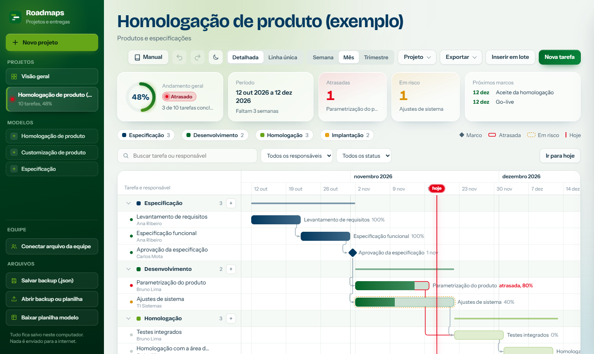
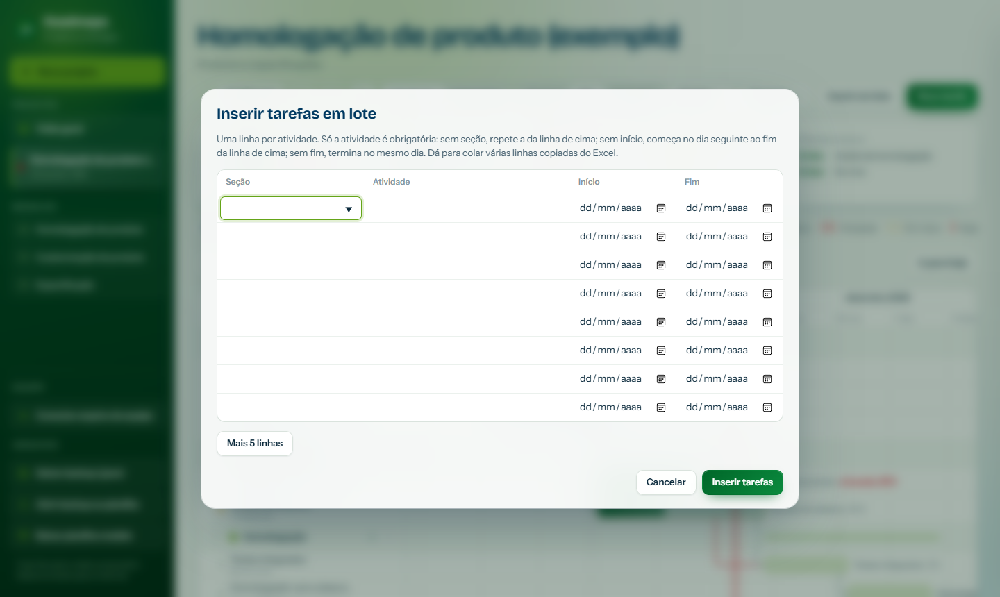

# Roadmap de projetos

Ferramenta para montar cronogramas e roadmaps de projetos no navegador. É um único arquivo HTML: não precisa instalar nada, não tem login e funciona sem internet.

**Usar agora:** https://pchiesi.github.io/Roadmap-projetos/

## O que dá para fazer

- A visão Detalhada é um Gantt com uma linha por tarefa: grupos coloridos, dependências, marcos, % concluído e zoom por semana, mês ou trimestre. Arraste uma barra para mudar as datas.
- A Linha única resume o projeto numa faixa de tarefas em sequência, com nome e datas. Com vários projetos (botão **Vários projetos** na barra do cronograma, ou **Vários na Linha única** na barra lateral), eles ficam um embaixo do outro sobre a mesma régua de meses, e dá para ver em que meses se cruzam. Para projetos com datas muito distantes, o zoom (**Tudo na tela**, **−**, **+** ou Ctrl + rodinha) e o resumo por **Fases**, **Projetos** ou **Macro** (um projeto por linha, nas datas reais, como a Visão geral) mostram tudo de uma vez.
- A Visão geral põe todos os projetos numa linha do tempo e mostra se cada um está no prazo, em atenção, atrasado ou concluído.
- Planejar D− monta o cronograma de trás para frente a partir de um marco: você dá um nome ao marco (por exemplo, o início do desenvolvimento da TI), informa a data dele e quantos dias úteis cada atividade leva, e o programa encaixa tudo antes dessa data, sem fins de semana e feriados. Se o marco mudar de data, é só replanejar. Dá para salvar a lista de atividades (com dias úteis, responsáveis e nome do marco) como modelo e escolher qual modelo abre por padrão. Para vários projetos de uma vez, **Importar vários projetos** lê uma planilha com uma linha por projeto: nome, dias úteis de cada atividade, a data do marco e, se quiser, uma coluna de responsável (os nomes das atividades e do marco ficam na linha de títulos).
- Inserir em lote abre uma tabela com Seção, Atividade, Responsável, Início, Fim e Marco. Você digita ou cola do Excel, cria seções novas ali mesmo, e o programa preenche o que ficar vazio.
- Para importar, baixe a planilha modelo, preencha no Excel e abra no programa. Uma planilha com várias abas vira vários projetos de uma vez: você escolhe as abas e dá um nome para cada projeto. A exportação gera um .xlsx com a lista de tarefas e um Gantt pintado.
- A linha de base guarda o plano original e mostra quantos dias cada tarefa atrasou ou adiantou.
- O relatório executivo mostra todos os projetos numa página, do mais crítico para o mais tranquilo, com um campo para as decisões que a diretoria precisa tomar. Dá para imprimir ou salvar em PDF.
- A exportação para PowerPoint gera slides editáveis (formas nativas, não imagem): resumo dos projetos, linha do tempo de todos na mesma régua e um cronograma por projeto.
- A situação considera o ritmo: tarefa que já começou e está 3 dias úteis atrás do previsto deixa o projeto em Atenção, e 10 dias ou mais conta como atrasada (limites ajustáveis em Critério das cores, para todos os projetos).
- Ao lado da situação aparece a tendência (melhorou, piorou ou estável em relação a 7 dias atrás), e o critério das cores pode ter tolerância em dias por projeto.
- **Recursos e conflitos** soma as atividades que acontecem ao mesmo tempo em todos os projetos (por atividade, grupo ou responsável), compara com as pessoas que você tem em cada linha (descontando as férias cadastradas) e mostra onde e quantas vão faltar. Exporta para Excel.
- A Visão geral ordena por situação, início, fim ou nome e filtra por situação (atrasados, atenção, no prazo, concluídos); a impressão, o Excel e o slide seguem a mesma escolha.
- A Visão geral pode ser impressa (ou salva em PDF) numa página limpa e exportada para Excel (tabela dos projetos e linha do tempo pintada por mês) ou para um PowerPoint de 1 slide com todos os projetos.
- Dá para excluir vários projetos de uma vez pela lixeira ao lado de Projetos, na barra lateral.
- A carga da equipe mostra, por pessoa e por semana, quantas tarefas abertas ela tem somando todos os projetos, com amarelo para duas ao mesmo tempo e vermelho para três ou mais.
- O caminho crítico destaca a sequência de tarefas que define a data final, calculada pelas dependências.
- Datas da empresa (congelamento, fechamento) e feriados nacionais, calculados sem internet, aparecem como faixas em todos os cronogramas e no PowerPoint.
- O Manual marca o que mudou na última versão, e o botão avisa quem ainda não viu.
- O HTML para envio é uma cópia só para leitura, que abre com dois cliques em qualquer computador.
- No modo equipe, várias pessoas editam o mesmo roadmap por um arquivo .json numa pasta do SharePoint ou OneDrive sincronizada.
- Cada projeto pode ter um logo (**Projeto › Adicionar logo**). Imagem de qualquer tamanho é reduzida e aparece sempre na mesma caixa, sem distorcer: no título, na lista de projetos, na Visão geral, na Linha única, no relatório, no PowerPoint e no HTML para envio.
- Cada tarefa aceita mais de um responsável (aparecem juntos na mesma linha, como "Ana / Bruno") e tem um checklist de até 15 itens no painel lateral, para marcar o que já foi feito.
- O botão **Editar grupos**, no começo da linha de grupos, abre a tela para renomear, mudar a cor, criar ou excluir grupos.
- Os menus seguem uma ordem fixa: na barra lateral, criar, painéis de todos os projetos, lista de projetos, modelos, equipe e arquivos; na barra do cronograma, à esquerda o que muda a visualização e à direita o que mexe no projeto, com **Nova tarefa** no fim; logo acima do cronograma ficam a escala, o Hoje e o zoom da Linha única. No celular, a barra lateral abre pelo botão **Menu**.
- Também tem busca e filtros, desfazer e refazer (Ctrl+Z / Ctrl+Y), modelos de projeto, tema claro e escuro e um Manual dentro do programa.

## Onde ficam os dados

Tudo fica salvo no navegador de quem está usando (localStorage). Nada é enviado para servidor nenhum, nem quando você usa a versão publicada aqui. Por isso:

- cada pessoa vê só os projetos que criou no próprio navegador;
- limpar os dados do navegador apaga os projetos. Use **Salvar backup (.json)** de vez em quando;
- para trabalhar em equipe, use **Conectar arquivo da equipe** (funciona no Edge e no Chrome).

## Usar sem internet

Baixe o [`index.html`](index.html) e abra o arquivo no navegador. Fontes e ícones estão dentro do arquivo, então ele funciona igual offline.

## Primeiros passos

1. Abra a página e clique em **Novo projeto**. Comece em branco ou a partir de um modelo.
2. Adicione tarefas com **Nova tarefa** ou **Inserir em lote**.
3. Clique em uma barra para editar responsáveis, datas, % concluído, checklist e dependências.
4. Na dúvida, o botão **Manual** no topo explica cada função.

## Licença

[MIT](LICENSE)
