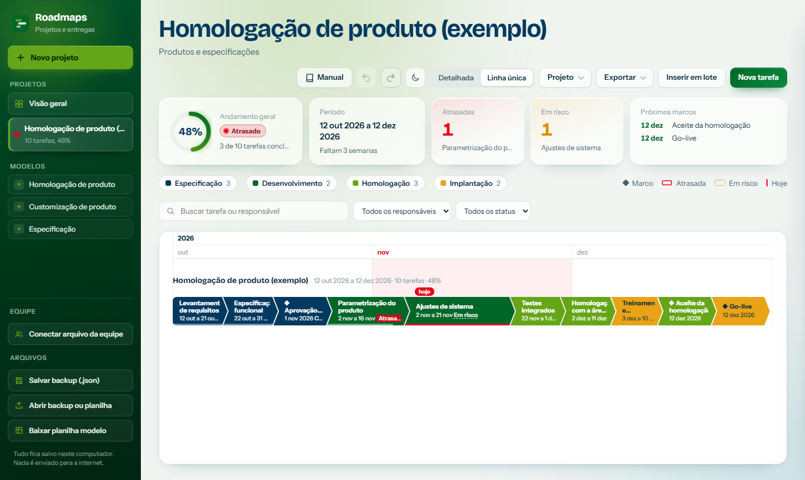

# Roadmap de projetos

Ferramenta para montar cronogramas e roadmaps de projetos no navegador. É um único arquivo HTML: não precisa instalar nada, não tem login e funciona sem internet.

**Usar agora:** https://pchiesi.github.io/Roadmap-projetos/

## O que dá para fazer

- A visão Detalhada é um Gantt com uma linha por tarefa: grupos coloridos, dependências, marcos, % concluído e zoom por semana, mês ou trimestre. Arraste uma barra para mudar as datas.
- A Linha única resume o projeto numa faixa de tarefas em sequência, com nome e datas. Com vários projetos, eles ficam um embaixo do outro sobre a mesma régua de meses, e dá para ver em que meses se cruzam.
- A Visão geral põe todos os projetos numa linha do tempo e mostra se cada um está no prazo, em atenção, atrasado ou concluído.
- Inserir em lote abre uma tabela com Seção, Atividade, Responsável, Início, Fim e Marco. Você digita ou cola do Excel, cria seções novas ali mesmo, e o programa preenche o que ficar vazio.
- Para importar, baixe a planilha modelo, preencha no Excel e abra no programa. Uma planilha com várias abas vira vários projetos de uma vez: você escolhe as abas e dá um nome para cada projeto. A exportação gera um .xlsx com a lista de tarefas e um Gantt pintado.
- A linha de base guarda o plano original e mostra quantos dias cada tarefa atrasou ou adiantou.
- O relatório executivo mostra todos os projetos numa página, do mais crítico para o mais tranquilo, com um campo para as decisões que a diretoria precisa tomar. Dá para imprimir ou salvar em PDF.
- A exportação para PowerPoint gera slides editáveis (formas nativas, não imagem): resumo dos projetos, linha do tempo de todos na mesma régua e um cronograma por projeto.
- Ao lado da situação aparece a tendência (melhorou, piorou ou estável em relação a 7 dias atrás), e o critério das cores pode ter tolerância em dias por projeto.
- O HTML para envio é uma cópia só para leitura, que abre com dois cliques em qualquer computador.
- No modo equipe, várias pessoas editam o mesmo roadmap por um arquivo .json numa pasta do SharePoint ou OneDrive sincronizada.
- Também tem busca e filtros, desfazer e refazer (Ctrl+Z / Ctrl+Y), modelos de projeto, tema claro e escuro e um Manual dentro do programa.

## Onde ficam os dados

Tudo fica salvo no navegador de quem está usando (localStorage). Nada é enviado para servidor nenhum, nem quando você usa a versão publicada aqui. Por isso:

- cada pessoa vê só os projetos que criou no próprio navegador;
- limpar os dados do navegador apaga os projetos. Use **Salvar backup (.json)** de vez em quando;
- para trabalhar em equipe, use **Conectar arquivo da equipe** (funciona no Edge e no Chrome).

## Usar sem internet

Baixe o [`index.html`](index.html) e abra o arquivo no navegador. Fontes e ícones estão dentro do arquivo, então ele funciona igual offline.

## Primeiros passos

1. Abra a página e clique em **Novo projeto**. Comece em branco ou a partir de um modelo.
2. Adicione tarefas com **Nova tarefa** ou **Inserir em lote**.
3. Clique em uma barra para editar responsável, datas, % concluído e dependências.
4. Na dúvida, o botão **Manual** no topo explica cada função.

## Licença

[MIT](LICENSE)
